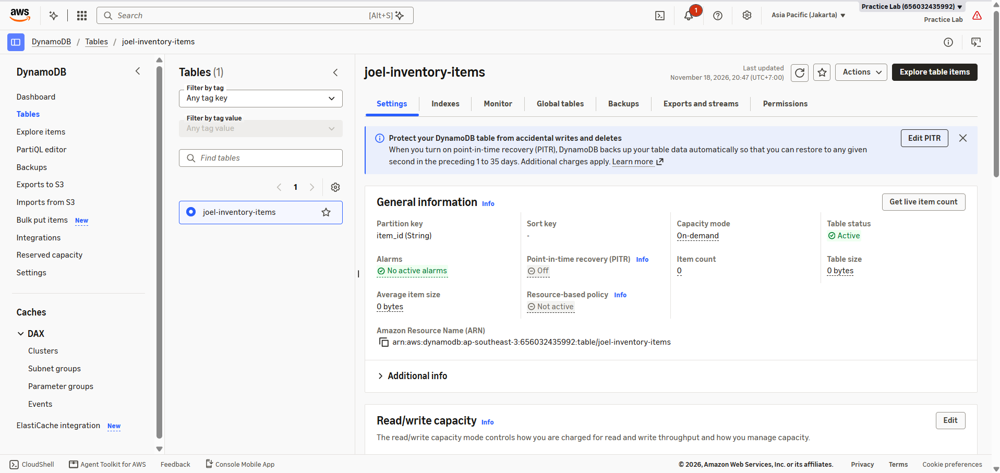
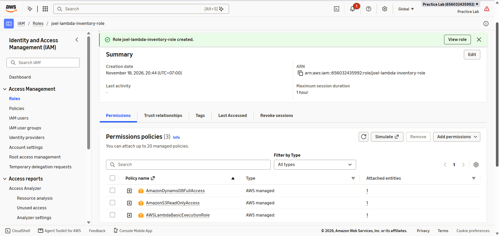
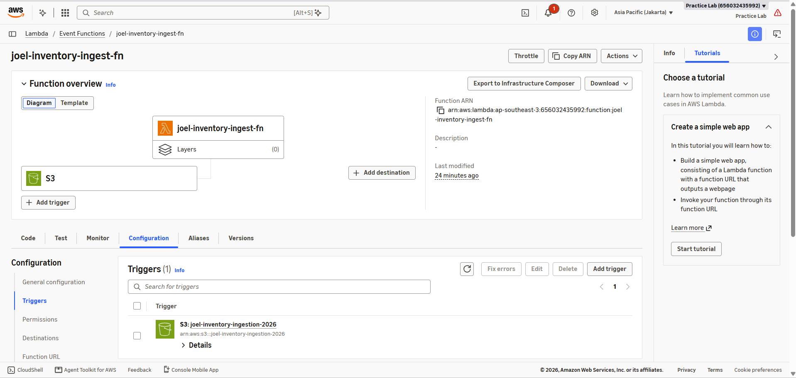
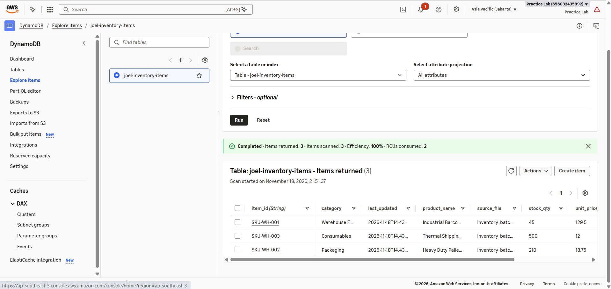
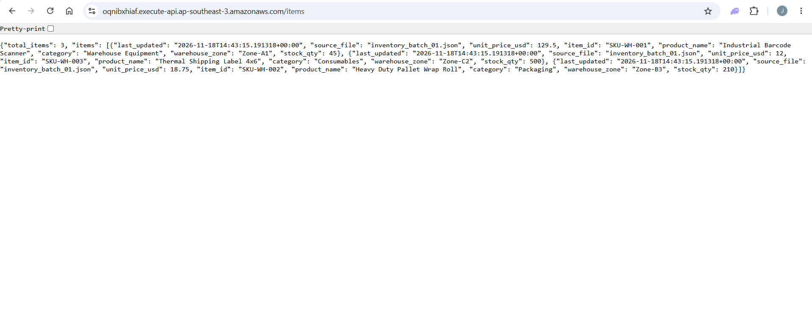

# AWS Serverless Event-Driven Inventory Pipeline

Arsitektur *event-driven serverless* di AWS untuk memproses unggahan data stok barang secara otomatis tanpa manajemen server.

## Arsitektur Sistem
Amazon S3 (Upload JSON) -> AWS Lambda (Python Parser) -> Amazon DynamoDB -> Amazon API Gateway (HTTP GET /items)

## Progress Implementasi
- [x] Part 1: DynamoDB Table (joel-inventory-items), S3 Ingestion Bucket, & IAM Execution Role
- [x] Part 2: AWS Lambda Python Functions, S3 Event Notification, & API Gateway Integration

## Bukti Infrastruktur & Pengujian End-to-End
### 1. Infrastruktur Dasar (DynamoDB, S3, IAM)

### 2. Event-Driven Ingestion & API Output

