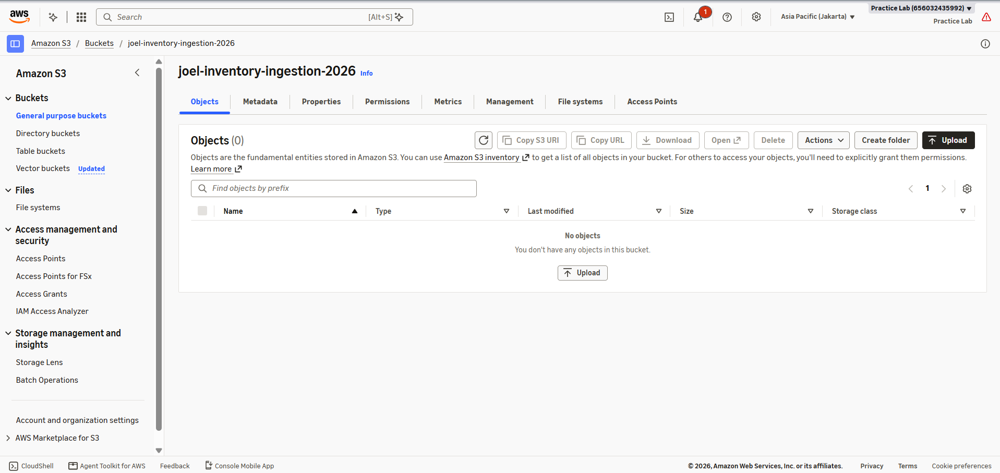

# AWS Serverless Event-Driven Inventory Pipeline

Arsitektur *event-driven serverless* di AWS untuk memproses unggahan data stok barang secara otomatis tanpa manajemen server.

## Arsitektur Sistem
Amazon S3 (Upload JSON/CSV) $\rightarrow$ AWS Lambda (Python Parser) $\rightarrow$ Amazon DynamoDB $\rightarrow$ Amazon API Gateway (REST Endpoint)

## Progress Implementasi
- [x] Part 1: DynamoDB Table (joel-inventory-items), S3 Ingestion Bucket, & IAM Least-Privilege Execution Role
- [ ] Part 2: AWS Lambda Python Function, S3 Event Notification, & API Gateway Integration

## Bukti Infrastruktur Dasar

